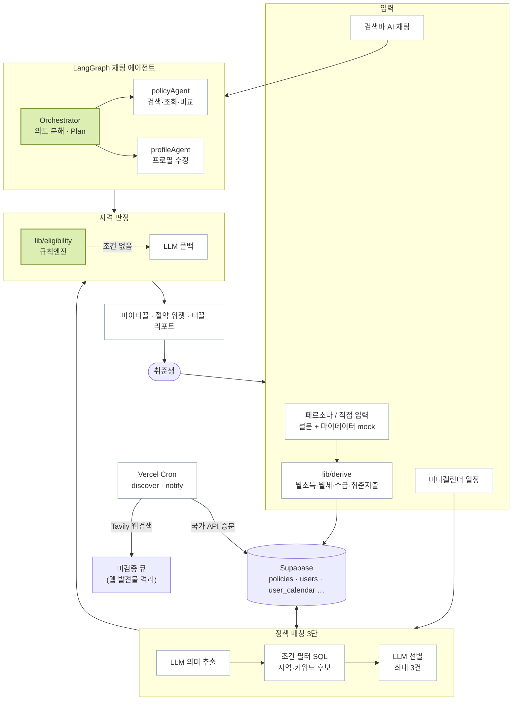

<div align="center">


# 티끌 (Tikkeul)

**영끌 아닌 티끌 — 취업 전의 티끌부터, 취업 후의 목돈까지**

내 상황과 일정을 알려주면 전국 **4,400여 개 청년·취준 정책**에서 받을 수 있는 혜택을 AI가 먼저 찾아
**절약액까지 계산**합니다. 시험·면접·이사·퇴사 같은 변화에 맞춰 필요한 지원을 연결하고,
내 조건에 맞는 채용공고와 취업 후 자산 계획까지 한곳에서 관리합니다.


`Next.js 16` · `LangGraph.js` · `Supabase` · `Groq / Claude`

[](https://tikle.vercel.app)
[](package.json)
[](tsconfig.json)

🏆 **2026 금융 AI Challenge 본선 진출(14팀 이내/ 536팀) (10/23 결과 업데이트 예정)**
금융보안 주최 — 팀 **코딩맹수**

</div>

---

## 무엇을 하는가

청년정책 포털·고용24 같은 기존 서비스는 **"Who you are"**(나이·지역·소득)로 검색하는 포털입니다.
취준생에게 필요한 건 **"What you're doing"** — 다음 주 면접, 시험 접수, 이사, 졸업에 맞춘 **선제적 안내**입니다.
정책을 놓치는 이유는 "몰라서"만이 아닙니다. 증빙(면접확인서·영수증)을 못 챙기거나, 예산 소진으로 조기 마감되기 때문입니다.
그래서 티끌은 **행동 이전에** 개입합니다.

| 단계 | 하는 일 |
|---|---|
| **1. 프로필 시작** | 페르소나 3종 선택(마이데이터 mock 자동 분석) 또는 직접 입력(설문 + 금융). 거래내역에서 월소득·월세·수급 수당·취준 지출을 **규칙 기반으로** 도출 |
| **2. 일정 → 정책 매칭** | 머니캘린더에 "9/18 SKT 면접"을 적으면 → 의미 추출 → 지역·키워드 SQL 후보 → LLM이 최대 3건 선별(이유·혜택·신청 링크) |
| **3. 상태 변화 감지** | "대전 이사" 일정 → 새로 열리는/사라지는 혜택 델타 리포트 → 적용 시 거주지 전환 |
| **4. 자격 판정** | 구조화 조건은 **규칙엔진**, 조건이 없는 정책만 LLM 폴백. `가능성 높음 / 추가 확인 필요 / 요건 미충족` + 근거·증빙 안내 |
| **5. 마이티끌 · 절약 위젯** | 담은 정책의 예상 절약액·건수 합산, 티끌 리포트 |
| **6. AI 채팅** | LangGraph 오케스트레이터가 의도를 분해 → 정책 검색·조회·비교 / 프로필 수정 에이전트 |
| **7. 채용공고** | 사람인·공공기관·고용24 공고 수집 → NCS 매칭 · 고용형태·경력·기관 필터 |
| **8. 취업 후 시뮬레이션** | 기업구분·연봉·목표 → 세후 실수령, 한 달 흐름, 3개 시나리오 도달 시점, 취업 후 열리는 제도 |
| **9. 신규 정책 발견** | 매일 크론이 국가 API 증분 재수집. 웹검색 발견물은 **미검증 큐로 격리** |

## 데모

> 🌐 **배포판** — https://tikle.vercel.app
>
> 🎬 **시연 영상** — 준비 중
> <!-- 예) [](https://youtu.be/VIDEO_ID) -->

로그인 없이 페르소나를 골라 바로 체험할 수 있습니다.

| | 페르소나 | 상황 |
|:--:|---|---|
|  | **김민지** | 시험 시즌 · 서울 중랑구 |
|  | **박준호** | 면접 러시 · 경기 수원 |
|  | **이서연** | 퇴사 후 전환 · 구직급여 수급 |

| | |
|---|---|
| 티끌 리포트 예시 | [`public/reports/minji-result-report-855b3887d310.png`](public/reports/minji-result-report-855b3887d310.png) |
| 기능명세서 | [`docs/reference/기능명세서.pdf`](docs/reference/기능명세서.pdf) |

---

## 빠른 시작

### 사전 준비

Node.js 20+ · Supabase 프로젝트 · `GROQ_API_KEY`

```bash
git clone https://github.com/Vaycold/AI_FINANCE.git
cd AI_FINANCE
npm install
cp .env.example .env.local     # 아래 표를 보고 키를 채웁니다 (절대 커밋 금지)
```

그다음 Supabase SQL Editor에서 [`supabase/schema.sql`](supabase/schema.sql) 을 실행해 테이블을 만듭니다.

환경변수 없이도 랜딩·페르소나 선택 화면은 뜹니다. DB·AI 기능은 `.env.local` 이 필요합니다.

**LLM provider** — 기본은 Groq(무료). 환경변수만 바꾸면 Claude로 전환됩니다.

| `LLM_PROVIDER` | 필요한 환경 변수 | 비고 |
|---|---|---|
| `groq` *(기본)* | `GROQ_API_KEY` · `GROQ_MODEL` | 기본 `openai/gpt-oss-120b` |
| `anthropic` | `ANTHROPIC_API_KEY` · `ANTHROPIC_MODEL` | 유료. 채팅만 Claude로 쓰려면 `LLM_CHAT_PROVIDER` |

용도별로 나눠 쓸 수 있습니다 — 대화(챗봇·에이전트)는 `LLM_CHAT_PROVIDER`(없으면 `LLM_PROVIDER`),
그 외 작업(공고 정규화·추천 선별·판정 해설)은 `LLM_TASK_PROVIDER`(없으면 `groq`).

### 실행

```bash
npm run dev                      # 개발 서버 → http://localhost:3000
npm run build && npm run start   # 파일감시 한도가 낮은 서버(리눅스 도커 등)에서는 이쪽
```

| 명령 | 하는 일 |
|---|---|
| `npm run lint` | ESLint |
| `npm run typecheck` | `next typegen` + `tsc --noEmit` |
| `npm run test` | 단위 테스트 (`src/**/*.test.ts`, `node:test`) |
| `npm run test:harness` | 하네스 실행기 테스트 (pytest 필요) |
| `npm run report:generate` | 티끌 리포트 이미지 생성 |

### 데이터 적재

```bash
node --import tsx scripts/seed.mts            # 페르소나 → DB 시드
python3 scripts/collect_gov24.py              # 행안부 공공서비스 수집 → 취준 필터
node --import tsx scripts/load_policies.mts   # 온통청년 → policies
node --import tsx scripts/load_gov24.mts      # gov24 → policies
node --import tsx scripts/collect_jobs.mts    # 채용공고 수동 수집 (크론과 로직 공유)
```

---

## 시스템 구조

**"숫자는 코드가, 해설은 AI가"** — 금액·날짜·자격 판정은 `src/lib/` 의 결정론적 코드가 정하고,
LLM은 그 결과를 설명·요약하거나 후보를 선별만 합니다. LLM 출력으로 금액·판정을 덮어쓰지 않습니다.



| 흐름 | 경로 |
|---|---|
| **시작** | 페르소나 mock / 직접 입력 → `/api/session` · `/api/signup` → `lib/derive` → `profile_survey` · `finance` · `users` |
| **일정** | `/api/events` → `/api/event-match` → 의미 추출 → `policies` SQL 후보 → LLM 선별 → `user_policy_matches` |
| **판정** | `/api/relevance` → `resolveProfile` → `classifyPolicyForUser` (규칙엔진 우선, LLM 폴백) |
| **채팅** | `/api/chat` → `agents/orchestrator` → `policyAgent` \| `profileAgent` → tools → `services/` |
| **시뮬** | `/api/simulate` → `lib/simulate`(결정론) → 취업 후 제도 판정 → LLM 해설 |
| **크론** | `/api/cron/discover` (정책·채용공고 증분, 매일) · `/api/cron/notify` (마감 알림) |

---

## 프로젝트 구조

```
.
├── src/
│   ├── app/                 페이지 + API 라우트 (App Router)
│   │   ├── page.tsx           랜딩
│   │   ├── app/               앱 화면 — 메인 · start · simulate · jobs · profile
│   │   └── api/               session · signup · events · event-match · relevance · recommend
│   │                          policies · policy-matches · profile-* · chat · simulate
│   │                          jobs/{search,recommend,skill-suggest} · cron/{discover,notify}
│   ├── components/          landing/(랜딩 섹션) · app/(앱 화면)
│   ├── agents/              LangGraph 채팅 에이전트 — orchestrator · policyAgent · profileAgent
│   ├── services/            외부 I/O (서버 전용) — supabase · llm · groq · tavily · policyMatch · collectJobs
│   ├── lib/                 순수 함수 + 단위 테스트 — derive · eligibility · simulate · region · rank …
│   ├── types/               공유 타입
│   ├── data/                정적 참고 데이터 — 페르소나 mock · NCS · 시험 · 취업 후 제도
│   └── config/brand.ts      서비스명·슬로건 단일 소스
│
├── scripts/                 정책·채용공고 수집/적재 · 하네스 실행기(execute.py) · hooks/
├── supabase/schema.sql      테이블 생성 SQL
├── docs/                    PRD · ARCHITECTURE · ADR · UI_GUIDE · reference/(기획·설계 원문)
├── phases/                  하네스 phase/step 정의
└── vercel.json              리전(icn1) · 크론 스케줄
```

의존 방향은 `app → agents → services → lib → types` 한 방향입니다.
클라이언트 컴포넌트는 `services/` · `agents/` 를 import하지 않습니다 — 서비스 키가 브라우저로 새지 않게.

## 핵심 설계

**결정론 우선 판정** — 행안부 API의 코드화된 자격조건(성별·나이·중위소득 구간·취업상태 등 50컬럼)과
온통청년 조건을 규칙으로 변환해 `lib/eligibility` 가 먼저 판정합니다. 구조화 조건이 없는 정책만 LLM이 판정하고,
그 결과도 `confirmed / excluded / insufficient_info` 로 코드가 확정합니다.

**정책 3단 검색** — `조건 필터(SQL) → 후보 압축(지역·키워드) → LLM 선별/판정`.
Naive RAG(임베딩 → top-k)가 아니라 메타데이터 필터 + 쿼리 확장 + LLM 리랭킹의 Advanced RAG 변형입니다.

**전국 커버리지** — 온통청년 청년정책 전수(261개 시·군·구) + 행안부 공공서비스 중 취준 관련분 + 큐레이션.
2026년 행정구역 개편(전남+광주 통합 등)으로 생긴 명칭 불일치는 `normalizeSido()` 로 LLM 출력·프로필·설문을 표준명으로 통일합니다.

**웹 발견물 격리** — Tavily 웹검색으로 찾은 정책은 검증 전까지 `policies` 에 넣지 않고 격리 큐에 둡니다.
국가 API 정책은 원본 해시가 바뀌면 갱신합니다(예: 지원금 인상 공고 반영).

**개인정보 최소화** — 회원가입·실명·연락처 없이 닉네임 세션만. LLM에는 판정에 필요한 속성만 보내고
닉네임·user id 같은 식별정보는 보내지 않습니다.

**하네스 기반 개발** — Claude Code 세션이 `CLAUDE.md` → `docs/*.md` 규칙을 따르고,
`src/lib/` 는 TDD 가드 훅이 테스트 없는 구현 편집을 차단합니다. 응답 종료 시 lint·typecheck·test 를 자동 검증합니다.

---

## 환경 변수

`.env.local` 에 설정합니다 (커밋 금지). 템플릿은 [`.env.example`](.env.example) 입니다.
배포판(Vercel)에는 Settings → Environment Variables 에 같은 이름으로 등록하고, **Preview 환경도 체크**해야 프리뷰가 동작합니다.

| 변수 | 필수 | 설명 |
|---|:--:|---|
| `SUPABASE_URL` · `SUPABASE_SERVICE_ROLE_KEY` | ✅ | DB (서버 전용 secret 키) |
| `GROQ_API_KEY` · `GROQ_MODEL` | ✅ | LLM 판정·매칭 |
| `LLM_PROVIDER` · `LLM_CHAT_PROVIDER` · `LLM_TASK_PROVIDER` | — | `groq` \| `anthropic` 전환 |
| `ANTHROPIC_API_KEY` · `ANTHROPIC_MODEL` | — | Claude 사용 시 |
| `TAVILY_API_KEY` | — | 정책 발견 크론 웹검색 · 검색바 미검증 폴백. 없으면 해당 기능만 생략 |
| `ONTONG_YOUTH_API_KEY` | — | 온통청년 정책 수집 |
| `DATA_GO_KR_API_KEY` | — | 행안부 공공서비스 · 공공기관 채용 수집 |
| `SARAMIN_API_KEY` · `WORK24_API_KEY` | — | 채용공고 수집. 없으면 해당 소스만 건너뜀 |
| `CRON_SECRET` | — | `/api/cron/*` 인증. 미설정이면 누구나 호출 가능 |

## 배포

Vercel 서울 리전(`icn1`). `main` 푸시 시 프로덕션에 자동 배포되고, 브랜치를 푸시하면 프리뷰 URL이 생깁니다.
작업은 **브랜치 → PR → 프리뷰 확인 → 머지** 순서로 하며, 프리뷰와 프로덕션은 같은 Supabase DB를 씁니다 —
스키마 변경은 `supabase/schema.sql` 에 먼저 적고 공유한 뒤 실행합니다.

크론 (`vercel.json`, UTC 기준):

| 경로 | 스케줄 | 하는 일 |
|---|---|---|
| `/api/cron/discover` | 매일 06:00 KST | 정책·채용공고 증분 수집, 웹 발견물 격리 |
| `/api/cron/notify` | 매일 07:00 KST | 정책 마감 알림 |

## 참고 문서

| 문서 | 내용 |
|---|---|
| [`docs/PRD.md`](docs/PRD.md) | 목표 · 사용자 · 핵심 기능 · MVP 제외 |
| [`docs/ARCHITECTURE.md`](docs/ARCHITECTURE.md) | 디렉토리 구조 · 의존 방향 · 데이터 흐름 |
| [`docs/ADR.md`](docs/ADR.md) | 기술 결정 기록 |
| [`docs/UI_GUIDE.md`](docs/UI_GUIDE.md) | 디자인 토큰 · 컴포넌트 · 금지 패턴 |
| [`docs/reference/`](docs/reference/) | 기획 원문 · 페르소나/DB 설계 · 정책 수집 기획 · 검색추천 3단 설계 · 기능명세서 |

## 팀

**코딩맹수** — 2026 금융 AI Challenge

| | 역할 | 연락처 |
|---|---|---|
| 김희민 | 팀장 · 시스템 설계 및 총괄 | khm1097@naver.com |
| 김병찬 | AI / 모델 개발 | moch1996@naver.com |

---

<div align="center">
<sub>티끌 · 2026 금융 AI Challenge</sub>
</div>
