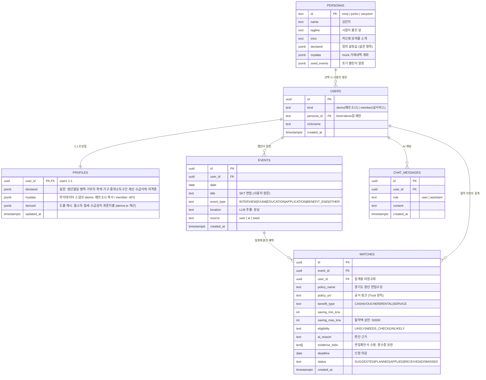

# DB 스키마 구조도 (현재 설계 기준)

> GitHub에서 이 파일을 열면 아래 다이어그램이 그림으로 렌더링됩니다.
> 원칙: **페르소나(데모)와 실사용자는 같은 구조** — `personas`는 템플릿, `users`+`profiles`는 인스턴스.

## ERD



## 테이블 역할 한 줄 요약

| 테이블 | 역할 | 생성 시점 |
|---|---|---|
| `personas` | 데모용 **템플릿** (시드 데이터, 3행 고정) | 배포 시 시드 |
| `users` | 서비스 이용 **주체** — 데모(익명)든 실회원이든 여기로 통일 | 페르소나 선택 / 회원가입 |
| `profiles` | users와 1:1 — declared(설문)+mydata(연동)+derived(도출) | users 생성 직후 (페르소나에서 복사) |
| `events` | 캘린더 일정 — **서비스의 심장** | 시드 자동등록 + 사용자 입력 + AI 제안 |
| `matches` | 일정에 붙은 혜택 = "일정에 붙은 돈" | 일정 등록 시 LLM 매칭 |
| `chat_messages` | AI 채팅 기록 | 채팅 시 |

## 흐름 위 데이터 생성 순서

```
페르소나 선택
  → users 1행 (kind='demo', persona_id='minji')
  → profiles 1행 (페르소나의 declared·mydata 복사 + derived 계산)
  → events N행 (페르소나 seed_events 복사, source='seed')
일정 추가 ("9/18 ○○기업 면접")
  → events 1행 (source='user')
  → LLM 분류·매칭 → matches N행 (eligibility·절약액·증빙·마감)
절약 리포트
  → SELECT sum(saving_max_krw) FROM matches WHERE user_id=? AND 기간·status 조건
```

## jsonb 내부 구조 (profiles)

- `declared` — [2차설계 2-1절](./2차설계_페르소나_DB.md) 설문 항목과 동일. 코드 타입: `src/data/personas.ts`의 `Declared`
- `mydata` — `{ asOf, accounts[], transactions[] }`. 코드 타입: `MyDataSnapshot`
- `derived` — `src/lib/derive.ts`의 `DerivedProfile` (재계산 가능한 캐시)

> jsonb로 둔 이유: 설문 항목이 아직 변동 가능하고, 정책 요건이 추가될 때마다 ALTER TABLE 없이 확장하기 위함.
> 자주 조회·필터하는 필드가 생기면 (예: 거주지로 인덱스 검색) 그때 컬럼으로 승격한다.

## 아직 없는 것 (다음 단계에서 논의)

- `policies` — 정책 원본 캐시 테이블 (지금은 LLM 매칭 결과를 matches에 바로 저장)
- `notifications` — 마감 D-day 알림 큐
- 실서비스 인증(users.auth) — Supabase Auth 연결 시 추가
