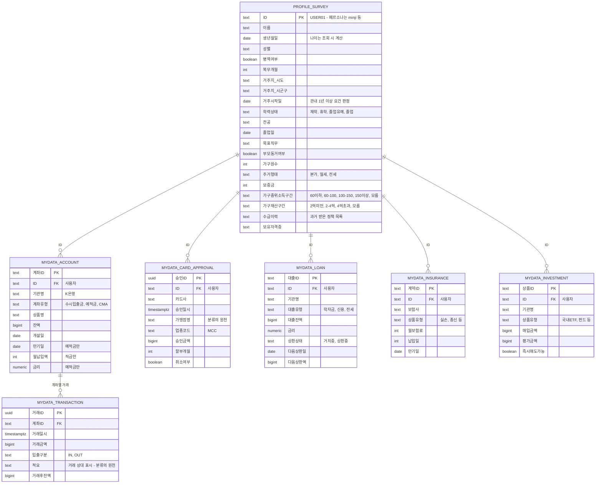

# DB 스키마 구조도 — 현재 시점

> GitHub에서 이 파일을 열면 다이어그램이 그림으로 렌더링됩니다. (안 보이면: [ERD_현재.png](./ERD_현재.png))
>
> 구조 원칙:
> - **PROFILE_SURVEY** — 마이데이터로 알 수 없어 설문으로 받는 정보 (페르소나: 임의 설정)
> - **MYDATA_[업권]** — 마이데이터 API가 주는 **RAW 원천 데이터 그대로** (가공 없음)
> - 도출값(월평균소득·월세감지·취준지출 등)은 **DB에 저장하지 않는다** — `src/lib/derive.ts`가 RAW에서 계산 (재계산 가능하므로 원천만 저장이 정석)

## ERD (현재)



## 현재 구현 범위

| 테이블 | 상태 | 비고 |
|---|---|---|
| PROFILE_SURVEY | ✅ mock 구현 | `personas.ts`의 `Declared` |
| MYDATA_ACCOUNT | ✅ mock 구현 | `personas.ts`의 `accounts` |
| MYDATA_TRANSACTION | ✅ mock 구현 | `personas.ts`의 `transactions` — 페르소나당 약 20건 |
| MYDATA_CARD_APPROVAL | 📐 스키마만 | 페르소나 확장 시 채움 (카드 소비 감지 정밀화) |
| MYDATA_LOAN | 📐 스키마만 | 학자금 대출 페르소나 추가 시 |
| MYDATA_INSURANCE | 📐 스키마만 | 보험료는 지금 거래내역 적요로 대체 중 |
| MYDATA_INVESTMENT | 📐 스키마만 | |

## RAW → 도출 (테이블이 아니라 계산)

```
MYDATA_TRANSACTION (RAW)
        │  src/lib/derive.ts (규칙 기반 계산, LLM 아님)
        ▼
도출값: 월평균근로소득, 가족지원월액, 월세이체액,
        수급제도 감지(제도명·월액·시작월·종료추정월),
        통신비·보험료월액, 취준지출총액·건수, 유동자산
```

- 도출값은 **저장하지 않고 매번 RAW에서 재계산** — 원천이 갱신되면 자동으로 따라온다
- 취준지출 판정: 현재는 적요 키워드 규칙(`응시료·토익·정장·KTX…`). 실서비스에서는 적요가 상호명(`YBM넷`)으로 오므로 가맹점 DB·업종코드(MCC) 매핑 + 잔여분 LLM 분류로 확장
- 나중에 성능 필요 시 도출 결과를 캐시 테이블로 추가할 수 있으나, 그때도 원천은 MYDATA_*

## 예시 데이터

**MYDATA_TRANSACTION** (이서연)

| 거래ID | 계좌ID | 거래일시 | 거래금액 | 입출구분 | 적요 |
|---|---|---|---|---|---|
| t-101 | SEOYEON_CHK | 2026-08-10 | 1,800,000 | IN | 고용노동부 구직급여 |
| t-102 | SEOYEON_CHK | 2026-08-05 | 550,000 | OUT | 월세 이체 |
| t-103 | SEOYEON_CHK | 2026-08-25 | 33,000 | OUT | GTQ 응시료 |

**MYDATA_ACCOUNT** (김민지)

| 계좌ID | ID | 기관명 | 계좌유형 | 잔액 |
|---|---|---|---|---|
| MINJI_CHK | minji | K은행 | 수시입출금 | 1,830,000 |
| MINJI_SAV | minji | K은행 | 적금 | 3,000,000 |

**PROFILE_SURVEY**

| ID | 이름 | 생년월일 | 거주지_시도 | 거주지_시군구 | 학력상태 | 가구중위소득구간 | 보유자격증 |
|---|---|---|---|---|---|---|---|
| minji | 김민지 | 2002-03-14 | 서울특별시 | 중랑구 | 졸업 | 100~150% | 컴퓨터활용능력 1급 |
| junho | 박준호 | 1999-07-02 | 경기도 | 수원시 | 졸업 | ~60% | 품질경영기사 |
| seoyeon | 이서연 | 1997-11-20 | 서울특별시 | 관악구 | 졸업 | 60~100% | |

## 나중에 추가될 테이블 (아직 미구현 — 연결하지 않음)

캘린더(EVENTS), 정책 매칭(MATCHES), 채팅(CHAT_MESSAGES) — 기능 구현 시점에 추가하고 이 문서를 갱신한다.
