# 2026 금융 AI Challenge 기능 명세서

| | |
|---|---|
| **팀명** | [등록 팀명 기재] |
| **구성원 성명** | 김병찬(팀장), [팀원 성명] |
| **서비스 명칭** | 티끌 (Tikkeul) — 취업준비생 취업 준비 비용 절감 AI Agent |
| **배포 URL** | https://tikle.vercel.app |
| **저장소** | https://github.com/Vaycold/AI_FINANCE |

---

## 1. MVP 구현 범위

예선 MVP에서 **실제 동작하도록 구현·배포한 범위**는 다음과 같습니다. (미구현·향후 예정 기능은 5절 제한사항에 별도 기재)

- **프로필 시작 2가지 경로** — ① 페르소나 3종 선택(마이데이터 표준 규격 mock 자동 분석) ② 직접 입력(설문 11항목 + 금융정보 6항목, 자동기입 지원) → 클라우드 DB 저장
- **마이데이터 → 금융 피처 도출** — 거래내역에서 월평균 근로소득·월세·수급 중 수당(종료 시점 추정)·취업준비 지출을 규칙 기반으로 계산(LLM 미사용)
- **정책 데이터베이스** — 온통청년 청년정책 전수 2,750건 + 행정안전부 공공서비스 취준 관련 592건 + 큐레이션 2건 = **3,344건**, 261개 시·군·구 커버
- **머니캘린더** — 월 달력에서 날짜 클릭 → 일정 등록 → DB 저장, 페르소나 기본 일정 자동 등록
- **일정 → AI 정책 매칭** — 일정 텍스트의 의미(유형·지역·키워드)를 AI가 추출 → 정책 DB 후보 압축 → 사용자 프로필과 대조해 최대 3건 추천(이유·혜택 요약·신청 링크)
- **상태 변화 감지(이사)** — 이사 일정 감지 → 거주지 변경 제안 → 새 지역에서 열리는 혜택 / 떠나면 사라지는 혜택 델타 리포트 → 적용 시 프로필 전환(이후 매칭이 새 거주지 기준)
- **정책 상세 + AI 자격 판정** — 지원대상·내용·신청방법·공식 링크 + "신청 가능성 높음 / 추가 확인 필요 / 요건 미충족" 판정, 근거, 미리 챙길 증빙
- **마이티끌** — 추천 정책 담기/빼기, 담은 정책의 예상 절약액·건수 위젯 실시간 합산
- **신규 정책 발견 자동화** — 매일 1회 국가 API 증분 재수집(신규 자동 편입), 웹 발견물은 검증 전 격리 큐 보관
- **취업 후 시뮬레이션** — 기업구분·연봉·목적(목돈/내집마련 권역/결혼) 입력 → 마이데이터 카드 승인내역·대출·월세 구조 위에 세후 실수령(중소기업 감면·공무원연금 반영)·여유자금·3 시나리오 도달 시점·취업 후 열리는 제도 14종 규칙 판정 + AI 해설

## 2. 주요 기능 목록

| # | 기능명 | 기능 설명 | 관련 화면 | 구현 상태 |
|---|---|---|---|---|
| F1 | 랜딩페이지 | 서비스 소개, 문제 정의, 작동 방식, 데이터 원칙 안내 | `/` | ✅ 구현 완료 |
| F2 | 페르소나 시작 | 김민지(시험 시즌·서울 중랑구) / 박준호(면접 러시·경기 수원) / 이서연(퇴사 후 전환·구직급여 수급) 선택 → 마이데이터 분석 연출 → 도출 프로필 카드 → 사용자 생성 | `/app/start` | ✅ 구현 완료 |
| F3 | 직접 입력 시작 | 설문(생년월일·거주지·학력·가구·중위소득구간 등) + 금융정보(월소득·자산·월세·대출·수급수당) 입력, ⚡자동기입 버튼 → `profile_survey`·`users`·`finance` 저장 | `/app/start` (직접 입력 폼) | ✅ 구현 완료 |
| F4 | 마이데이터 도출 엔진 | 거래내역 → 정기 입금 패턴(소득), 정기 이체(월세), 수당 입금(수급·종료 추정), 취준 지출 감지 — 결정론적 규칙 | `/app/start` 결과 카드 | ✅ 구현 완료 |
| F5 | 머니캘린더 | 월 달력, 날짜 클릭 선택, 일정 등록·DB 저장, 일정 pill 표시, 페르소나 기본 일정 시드 | `/app` 중앙 | ✅ 구현 완료 |
| F6 | 일정 → AI 정책 매칭 | 일정 등록 즉시 AI가 의미 추출 → 정책 DB에서 지역·키워드 후보 → 프로필 대조 후 최대 3건(관련도·이유·혜택·링크) | `/app` 선택 날짜 패널 "💡 일정에 붙는 혜택" | ✅ 구현 완료 |
| F7 | 이사 감지 · 델타 리포트 · 프로필 전환 | "대전 이사" 등 감지 → 거주지 변경 카드 → 🟢 새로 열리는 혜택 / 🔴 사라지는 혜택 → [n/n부터 적용]·[지금부터 적용] → `profile_changes` 기록, 헤더 🏠 배지, 이후 매칭 새 거주지 기준 | `/app` 선택 날짜 패널 | ✅ 구현 완료 |
| F8 | 정책 자세히보기 | 지원대상·지원내용·신청방법·공식 페이지 링크·담기 | `/app` 모달 | ✅ 구현 완료 |
| F9 | AI 자격 판정 | 사용자 프로필 × 정책 조건 → 판정 배지·관련도·근거·확인 필요 항목·미리 챙길 증빙 | `/app` 모달 내 | ✅ 구현 완료 |
| F10 | 마이티끌 담기 · 절약 위젯 | 추천 ↔ 마이티끌 이동, "이번 달 아낄 티끌"(예상액 합) · "담은 혜택 N건" 원 위젯 | `/app` 좌측·우측 | ✅ 구현 완료 (브라우저 저장) |
| F11 | 추천 탭 | 페르소나별 대표 정책 3건 노출(자세히보기·AI 판정·담기 연결) | `/app` 좌측 | △ 정적 목록 ("데모 추천" 표기) — AI 매칭은 F6·F9에서 동작 |
| F12 | 신규 정책 발견 크론 | 매일 06:00 온통청년·행안부 API 최신분 점검 → 신규 자동 편입, 웹 발견물 격리 큐 | `/api/cron/discover` (JSON) | ✅ 구현 완료 |
| F13 | 취업 후 시뮬레이션 | 기업구분·연봉·목적 입력 → 세후 실수령, 한 달 흐름(고정·대출·소비·저축), 카드 소비 상위, 목표 도달 시점 3 시나리오, 대출 상환/저축 판정, 취업 후 열리는 제도(가능성 높음/확인 필요), AI 코치 해설 | `/app` 우측 카드 → 모달 | ✅ 구현 완료 (결과 미저장) |

## 3. 사용자 이용 흐름 (가이드북)

> 계정·로그인 불필요. 데스크톱 브라우저에서 https://tikle.vercel.app 접속.

### STEP 1. 랜딩 — 서비스 소개
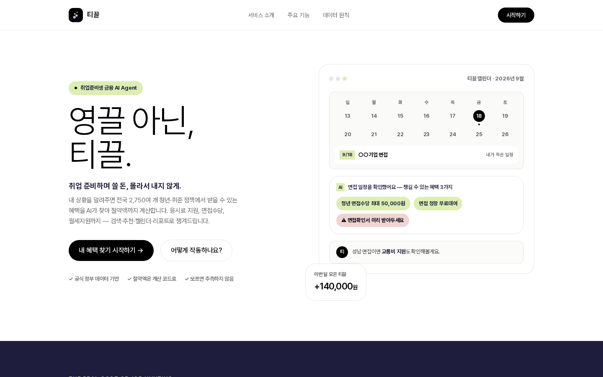
- 상단 우측 **[시작하기]** 또는 히어로의 **[내 혜택 찾기 시작하기 →]** 클릭
- 우측 목업은 "일정을 적으면 혜택이 붙는" 핵심 장면을 미리 보여줍니다

### STEP 2. 시작 — 프로필 선택
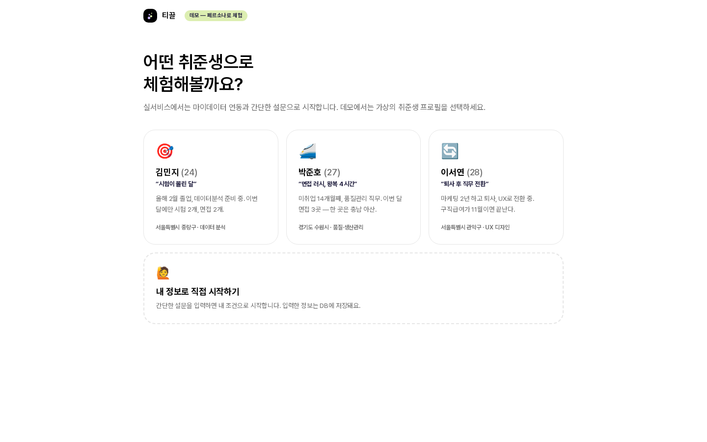
- **페르소나 3종** 중 하나를 클릭하거나, 하단 **[🙋 내 정보로 직접 시작하기]** 선택
- 페르소나 카드에는 나이·거주지·목표 직무·상황 한 줄이 표시됩니다

### STEP 3. 페르소나 선택 시 — 마이데이터 분석 → 도출 프로필
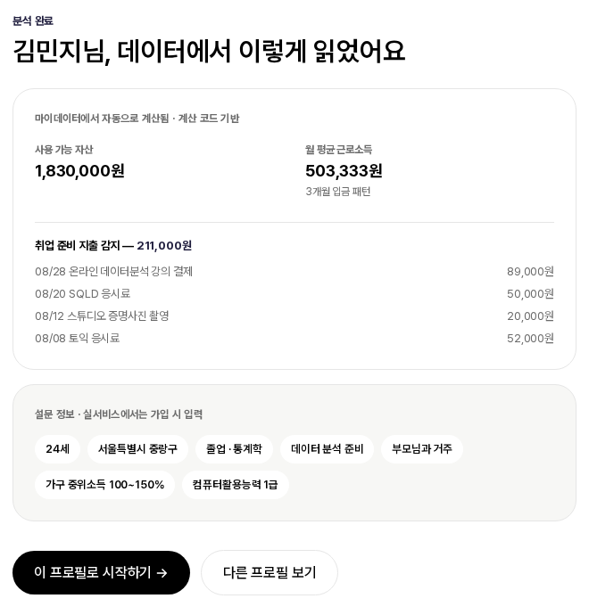
- "마이데이터 연결 중 → 거래내역 분석 중 → 취준 지출 감지 중" 연출 후 **도출 프로필 카드** 표시
- 상단 카드: 마이데이터에서 **코드가 계산한 값** — 사용 가능 자산, 월 평균 근로소득(3개월 패턴), 월세, 수급 중 수당(⚠종료 추정), 취업 준비 지출 감지 목록
- 하단 카드: **설문 정보**(나이·지역·학력·가구·중위소득 구간 등) — 실서비스에서는 가입 시 입력
- **[이 프로필로 시작하기 →]** 클릭 → 사용자가 DB에 생성되고 앱으로 이동

### STEP 4. 직접 입력 시 — 설문 + 금융정보 (자동기입)
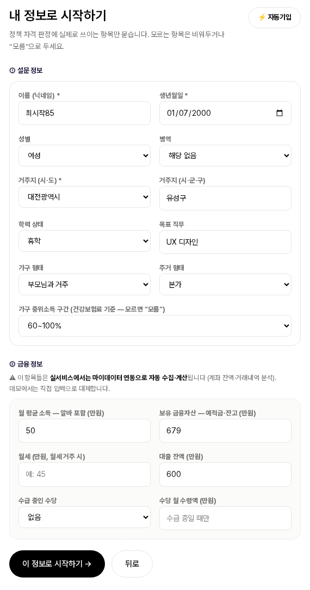
- ① 설문 정보 11항목(모르는 항목은 "모름" 선택 가능)
- ② 금융 정보 6항목 — *"실서비스에서는 마이데이터 연동으로 자동 수집·계산됩니다. 데모에서는 직접 입력으로 대체합니다"* 안내
- 우측 상단 **[⚡ 자동기입]**: 거주지와 일관된 그럴듯한 값으로 전체 자동 채움
- **[이 정보로 시작하기 →]** → `profile_survey`·`users`·`finance` 3개 테이블에 저장 후 앱으로 이동

### STEP 5. 앱 메인 화면
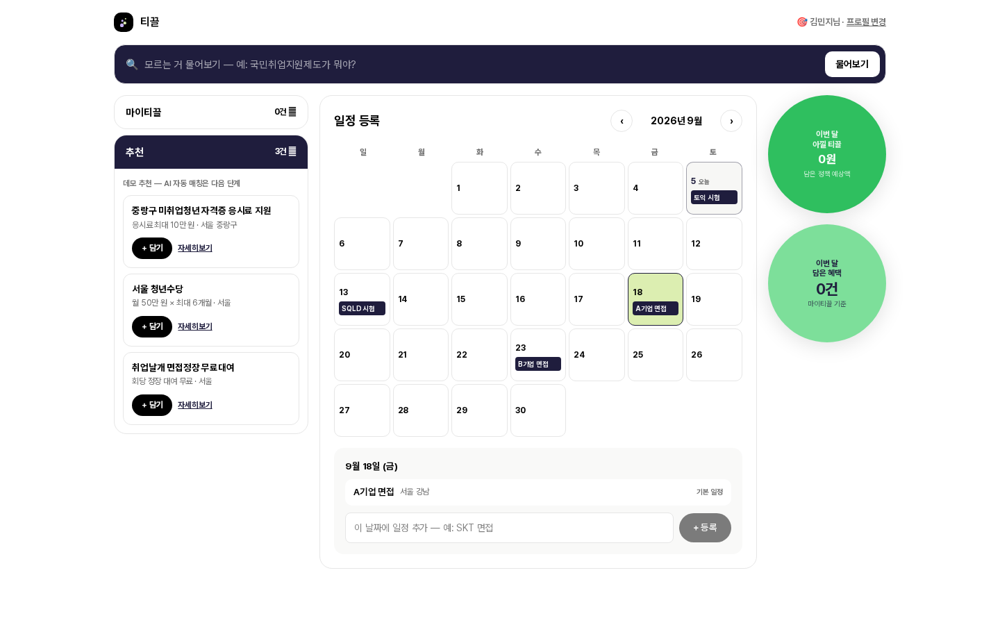
- **상단 검색바**: AI 질문 입구(MVP에서는 UI만 — 5절 제한사항)
- **좌측**: 마이티끌 / 추천 아코디언(하나를 열면 다른 하나가 닫힘). 추천 카드에 [+ 담기]·[자세히보기]
- **중앙**: 일정 등록 — 노션식 월 달력. 오늘 표시, 페르소나 기본 일정(토익·SQLD·면접 등) pill
- **우측**: 절약 위젯 원 2개 — 이번 달 아낄 티끌(담은 정책 예상액 합) · 담은 혜택 건수

### STEP 6. 일정 등록 → AI가 혜택을 붙임
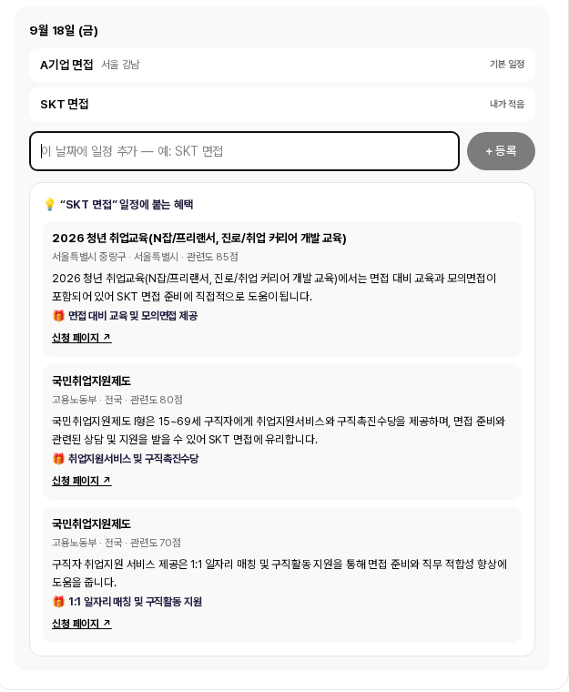
- 달력 **날짜 칸 클릭**(예: 18일) → 아래 패널에 그 날 일정 목록 + 입력창
- **"SKT 면접"** 입력 → **[+ 등록]** → 일정이 DB 저장되고 달력에 pill로 표시
- 5\~15초 후 **"💡 'SKT 면접' 일정에 붙는 혜택"** 카드: 정책명 · 기관 · 지역 · 관련도 점수 · **왜 이 사용자·일정에 맞는지** · 🎁 혜택 요약 · 신청 페이지 링크
- 예시 결과: 청년 취업교육(면접 대비 교육·모의면접), 국민취업지원제도(취업지원 서비스·구직촉진수당)

### STEP 7. 이사 일정 → 거주지 변경 감지 · 델타 리포트 · 프로필 전환
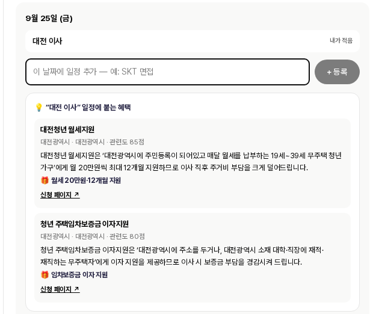
- 25일 클릭 → **"대전 이사"** 등록
- (상단) 이사에 **직접 붙는 혜택**: 대전청년 월세지원(월 20만 원×12개월), 청년 주택임차보증금 이자지원

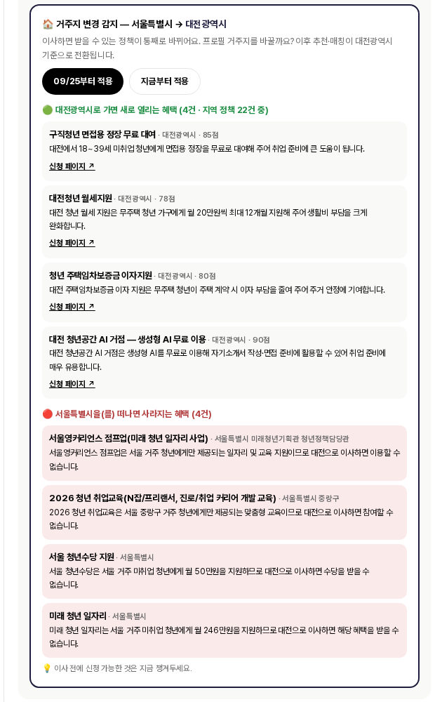
- (하단) **🏠 거주지 변경 감지 — 서울특별시 → 대전광역시** 카드:
  - **[09/25부터 적용]** 또는 **[지금부터 적용]** → 프로필 거주지 변경이 기록되고 이후 추천·매칭이 대전 기준으로 전환, 헤더에 🏠 배지 표시
  - **🟢 대전으로 가면 새로 열리는 혜택** — 면접용 정장 무료 대여, 청년공간 AI 거점(생성형 AI 무료), 월세지원, 임차보증금 이자지원 …
  - **🔴 서울을 떠나면 사라지는 혜택** — 서울 청년수당, 미래 청년 일자리, 청년 취업교육 … + "이사 전에 신청 가능한 것은 지금 챙겨두세요"

### STEP 8. 정책 자세히보기 → AI 자격 판정
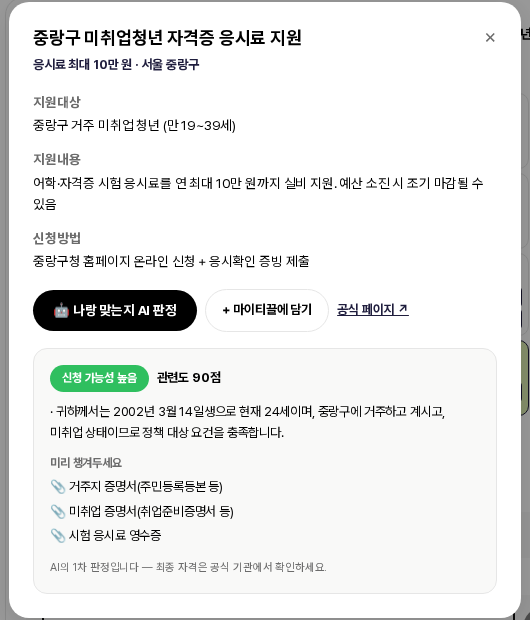
- 추천/마이티끌 카드의 **[자세히보기]** → 모달: 지원대상 · 지원내용 · 신청방법 · [공식 페이지 ↗]
- **[🤖 나랑 맞는지 AI 판정]** 클릭 → 3\~10초 후:
  - 판정 배지 **신청 가능성 높음 / 추가 확인 필요 / 요건 미충족 가능성** + 관련도 점수
  - **근거**(예: "2002년생 24세, 중랑구 거주, 미취업 상태 → 대상 요건 충족")
  - **확인이 필요해요**(모르는 조건이 있을 때 — 추측하지 않음)
  - **미리 챙겨두세요**(거주지 증명서, 미취업 증명서, 응시료 영수증 등)
  - 하단 고지: "AI의 1차 판정입니다 — 최종 자격은 공식 기관에서 확인하세요"

### STEP 9. 마이티끌에 담기 → 절약 위젯 반영
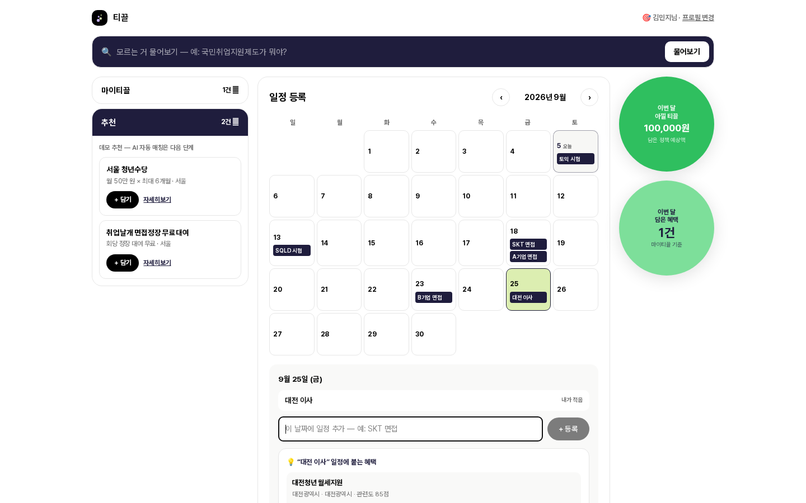
- [+ 담기] → 정책이 **마이티끌** 탭으로 이동("진행중" 상태), 우측 위젯의 **이번 달 아낄 티끌 금액·담은 혜택 건수**가 즉시 갱신
- [빼기]로 되돌릴 수 있음. 헤더 "프로필 변경"으로 다른 페르소나·직접 입력으로 다시 시작 가능

### STEP 10. 취업 후 시뮬레이션 — 연봉·목표를 넣으면 돈의 흐름과 열리는 제도
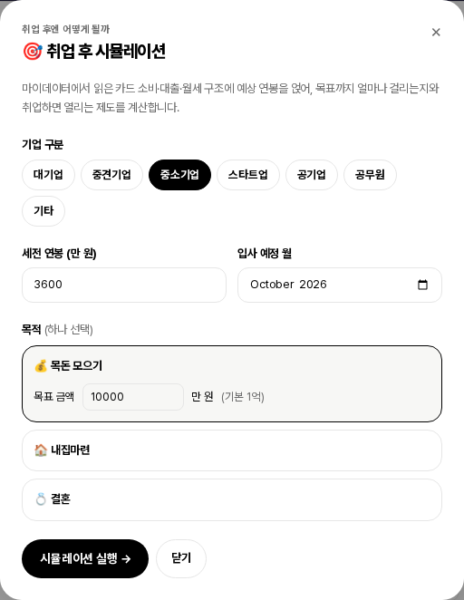
- 우측 원 위젯 아래 **[🎯 취업 후 시뮬레이션]** 카드 클릭 → 입력 모달
- **기업 구분**(대기업·중견·중소·스타트업·공기업·공무원·기타), **세전 연봉**(만 원), **입사 예정 월**, **목적**(💰 목돈 금액 / 🏠 내집마련 권역 7개 / 💍 결혼) 선택 → **[시뮬레이션 실행 →]**
- 페르소나는 마이데이터 카드 승인내역·대출·월세를 자동으로 읽고, 직접 입력 사용자는 월 카드 소비 한 칸을 추가로 입력

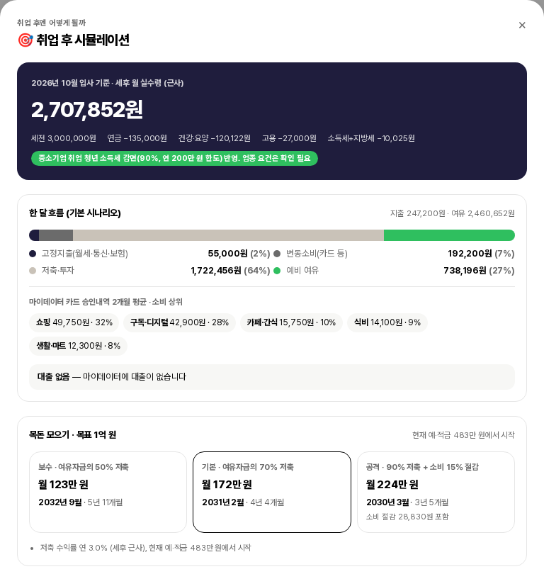
- **세후 월 실수령**(4대보험·소득세 공제 내역, 중소기업 청년 소득세 감면 또는 공무원연금 반영 표시)
- **한 달 흐름 막대**: 고정지출(월세·통신·보험) / 대출 상환 / 변동소비(카드) / 저축·투자 / 예비 여유 + 마이데이터 카드 소비 상위 카테고리 + 대출 **상환 우선 / 저축 병행** 판정(금리 기준)
- **목표 카드**: 목표 금액(내집이면 참고 주택가격·필요 자기자본·부대비용·대출 필요액), 보수·기본·공격 3 시나리오의 **월 저축액과 도달 시점**

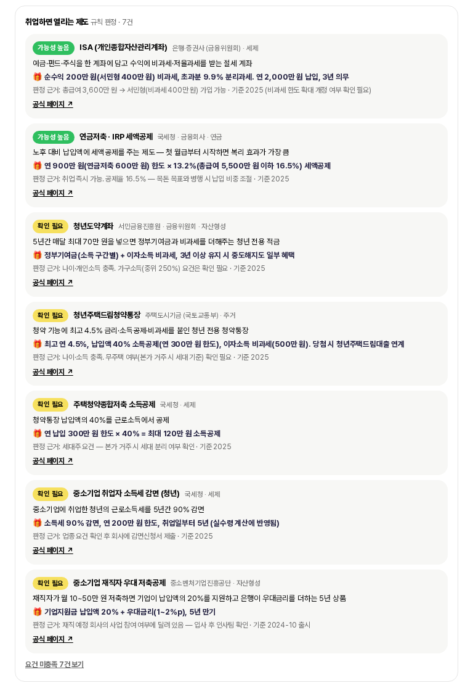
- **취업하면 열리는 제도**: 청년도약계좌·ISA·청년주택드림청약통장·중소기업 소득세 감면·재직자 우대저축·월세 세액공제·디딤돌·보금자리론·신혼부부·연금저축 등 14종 중 규칙 판정으로 **가능성 높음 / 확인 필요**만 표시(미충족은 접힘). 각 카드에 무엇인지·혜택·판정 근거·기준 시점·공식 링크

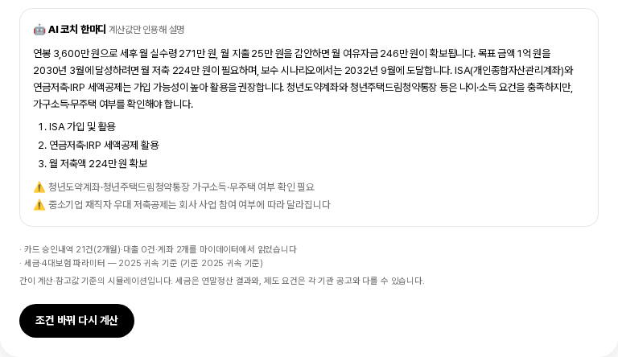
- **AI 코치 한마디**: 계산값만 인용한 요약·우선순위 3개·주의 2개. 하단에 마이데이터 읽은 범위, 참고값 출처·기준 시점, 간이 계산 고지. **[조건 바꿔 다시 계산]**으로 연봉·목표를 바꿔 비교

## 4. AI 및 데이터 처리 방식

### 4.1 AI가 수행하는 역할 (생성형 AI: Groq API · `openai/gpt-oss-20b`, JSON 모드)

| 역할 | 입력 | 출력 | 규칙 |
|---|---|---|---|
| ① 일정 의미 추출 | 일정 텍스트·날짜 ("대전 이사", 9/25) | 유형(면접·시험·교육·이사·졸업·퇴사·취업…), 지역(표준 시도명), 검색 키워드 3\~6개 | 지역명은 코드가 표준명으로 재정규화 |
| ② 정책 선별·이유 생성 | 사용자 프로필 요약 + 정책 후보(SQL 필터 결과 최대 22건) | 최대 3건 {정책ID, 관련도 0\~100, 이유 1문장, 혜택 요약} | 후보 밖 정책 생성 금지 · 무관하면 빈 배열 · 60점 미만 제외 |
| ③ 자격 판정 | 사용자 프로필(설문+금융 피처) + 정책 1건(대상·내용) | {점수, LIKELY/NEEDS_CHECK/UNLIKELY, 근거[], 확인 필요[], 증빙[]} | 모르는 조건은 추측 대신 NEEDS_CHECK · 단기 알바는 미취업 배제 안 함 · 금액·날짜 창작 금지 |
| ④ 이사 델타 선별 | 프로필 + 새 지역 정책 후보(취준 키워드 선별 60건) + 현 거주지 정책 후보(30건) | 새로 열리는 최대 6건(점수·이유) / 사라지는 최대 4건(이유) | 결혼·출산·농업·창업 등 취준 무관 정책 제외 |
| ⑤ 시뮬레이션 해설 | 코드가 계산한 실수령·지출·시나리오·대출 판정·열리는 제도 목록 | {요약 3~4문장, 우선순위 3, 주의 2} | 제공된 숫자만 인용·새 숫자/금리/기간 생성 금지 · 제도는 목록 안에서만 · 실패 시 계산 결과만 표시 |

**AI가 하지 않는 것**: 소득·월세·자산·절약액 계산, 세후 실수령·도달 시점 계산, 자격의 하한선(지역·나이·마감) 판정 → 전부 결정론적 코드(SQL 필터, `derive.ts`, `simulate.ts`)가 수행. LLM은 "후보 안에서 고르고 설명하는" 역할에 한정.

**처리 파이프라인(3단)**: SQL 조건 필터(전국∨일정지역∨거주지 ∧ 나이 ∧ 마감) → 키워드 확장 검색 → LLM 판정. 안정성: `reasoning_effort: low`, JSON 스키마 강제, 실패 시 1회 재시도.

### 4.2 사용 데이터

| 데이터 | 출처 | 규모 | 저장 |
|---|---|---|---|
| 청년정책 | 온통청년 청년정책 Open API (국무조정실) | 2,750건 전수, 261개 시군구 | Supabase `policies` |
| 공공서비스(혜택) | 행정안전부 대한민국 공공서비스 API | 전체 10,956건 중 취준 관련 592건 | 동일 테이블 (`source` 구분) |
| 큐레이션 정책 | 지자체 자체 채널(대전시 청년공간 AI 거점 등, 국가 API 미등록) | 2건 | 동일 테이블 (`source=curated`, 출처 명시) |
| 페르소나 마이데이터 | 마이데이터 표준 규격을 따른 **가상(mock)** 계좌·거래내역·카드 승인내역·대출 | 3인, 거래 53건, 카드 승인 57건, 대출 2건 | `mydata_account` `mydata_transaction` `mydata_card_approval` `mydata_loan` |
| 시뮬레이션 참고값 | 세율·4대보험 요율(2025 귀속), 권역별 아파트 중위가격(KB부동산·한국부동산원 기반 반올림), 평균 결혼비용(듀오 2024) | 코드 상수 | `src/data/postjob_reference.ts` (출처·기준시점 표기) |
| 취업 후 제도 | 청년도약계좌·ISA·청년주택드림청약 등 14종 큐레이션, 요건 규칙화 | 14건 | `src/data/postjob_programs.ts` |
| 사용자 프로필 | 페르소나 설정값 또는 직접 입력 설문·금융정보 | — | `profile_survey` `finance` `users` |
| 일정·프로필 변경 | 사용자 입력 | — | `user_calendar` `profile_changes` |

### 4.3 입력·출력 데이터 요약

- **입력**: 프로필(나이·거주지·학력·취업상태·가구·중위소득구간 등), 금융 피처(월소득·월세·자산·수급수당), 일정 텍스트·날짜, 정책 원문(지원대상·내용)
- **출력**: 추천 정책 카드(정책명·기관·지역·관련도·이유·혜택·링크), 자격 판정(배지·근거·확인필요·증빙), 델타 리포트(열리는/사라지는 혜택), 도출 프로필(소득·월세·수급·취준지출), 취업 후 시뮬레이션(실수령·배분·시나리오·열리는 제도·AI 해설)

### 4.4 개인정보·민감정보 처리

- **회원가입·로그인 없음**, 이메일·전화번호·실명·계좌번호 **미수집**
- 페르소나는 전부 **가상 인물·가상 거래내역**. 마이데이터 **실연동 없음**(표준 규격 mock)
- 직접 입력 시 사용자가 스스로 적은 닉네임·생년월일·거주지·학력·소득 구간·금융 정보가 Supabase(서울 리전)에 저장됨. DB 접근은 서버 전용 비밀키로만, 브라우저에 키 노출 없음
- 생성형 AI(Groq API)에는 **판정에 필요한 속성만** 전송하며 ID·닉네임 등 식별정보는 제외. AI 응답은 저장하지 않고 화면에만 표시(마이티끌 담기는 브라우저 저장)
- 대회 종료 후 데모 입력 데이터는 일괄 삭제 가능

## 5. MVP 검증 방법

### 5.1 심사 절차 (약 10분)

| 단계 | 조작 | 예상 결과 |
|---|---|---|
| A. 접속 | https://tikle.vercel.app → [시작하기] | 페르소나 3장 + 직접 입력 카드 |
| B. 페르소나 시작 | **김민지** 클릭 → 분석 연출 → [이 프로필로 시작하기] | 도출 프로필: 월 평균 근로소득 **503,333원**(3개월 패턴), 취준 지출 211,000원 등 → 앱 메인 이동, 달력에 기본 일정(토익·SQLD·면접) 표시 |
| C. 일정 매칭 | 달력 **18일** 클릭 → 입력창에 `SKT 면접` → [+ 등록] | 5\~15초 후 "💡 일정에 붙는 혜택" 카드 1\~3건(면접·취업지원 관련, 이유·링크 포함) |
| D. 이사 감지 | **25일** 클릭 → `대전 이사` → [+ 등록] | 직접 혜택(대전청년 월세지원 등) + 🏠 거주지 변경 카드(열리는 혜택·사라지는 혜택) → [09/25부터 적용] → "적용됨", 헤더에 🏠 배지 |
| E. 자격 판정 | 좌측 추천 "중랑구 미취업청년 자격증 응시료 지원" [자세히보기] → [🤖 나랑 맞는지 AI 판정] | **신청 가능성 높음**(80\~95점) + 근거(나이·중랑구 거주·미취업) + 증빙 안내 |
| F. 부정 판정 확인 | 헤더 [프로필 변경] → **이서연**(구직급여 수급 중) 선택 → 추천의 "국민취업지원제도 (수급 종료 후 연계)" [자세히보기] → [🤖 AI 판정] | **요건 미충족 가능성**(10점 내외) + 근거 "현재 구직급여 수급 중이므로 수급 종료 후 연계 대상이 아닙니다" — 프로필의 수급 상태를 읽어 배제하는지 확인 |
| G. 직접 입력 | [프로필 변경] → [내 정보로 직접 시작하기] → [⚡ 자동기입] → [이 정보로 시작하기] | 앱 메인 진입(빈 달력), 입력값이 DB 저장됨. 일정 등록 시 입력한 거주지 기준으로 매칭 |
| H. (선택) 자동 수집 확인 | 브라우저에서 `https://tikle.vercel.app/api/cron/discover` 열기 | JSON 리포트(`ontong_checked`, `gov24_checked`, `policies_total: 3344…`) |
| I. 취업 후 시뮬레이션 | 김민지 상태에서 우측 [🎯 취업 후 시뮬레이션] → 중소기업 · 3,600만 원 · 목돈 1억 → [시뮬레이션 실행] | 세후 월 실수령 **약 271만 원**(중소기업 감면 반영 표시), 카드 소비 상위 쇼핑·구독, 기본 시나리오 월 약 172만 원 저축 → 약 4년 4개월 후 도달, 열리는 제도 7건(ISA·연금저축 가능성 높음 등), AI 해설 |

### 5.2 샘플 입력값

| 입력 | 기대 결과 |
|---|---|
| `SKT 면접` (김민지, 9/18) | 면접·취업지원 정책 (청년 취업교육, 국민취업지원제도 등) |
| `대전 이사` (김민지, 9/25) | 대전청년 월세지원·임차보증금 이자지원 + 거주지 변경 카드(열리는 4\~6건 / 사라지는 4건) |
| `광주로 이사` (김민지) | 전남광주통합특별시 정책(동구·서구 웰컴 박스, 청년월세지원 등) + 델타 |
| `대전에서 자기소개서 준비` | 면접 정장 무료대여, 대전 청년공간 AI 거점(생성형 AI 무료) |
| `토익 시험` / `SQLD 시험` | 자격증·어학 응시료 지원 계열 |
| 시뮬레이션: 이서연 · 공무원 · 3,300만 · 결혼 | 공무원연금 9% 반영, 마이너스통장(6.8%) **상환 우선** 판정, 결혼 자금 3,250만 목표 기본 시나리오 약 2년 4개월 |
| 시뮬레이션: 박준호 · 대기업 · 4,800만 · 내집 수도권 | 참고 주택가격 5.2억 → 필요 자기자본 1억 7,160만, 학자금(1.7%) 저축 병행, 청년주택드림청약·월세 세액공제 가능성 높음 |

### 5.3 실행 환경

- **계정 불필요**, 별도 설치 없음
- 권장: 데스크톱 **Chrome / Edge 최신 버전**, 화면 폭 1280px 이상 (모바일은 기본 반응형 대응, 3단 레이아웃은 세로 배치)
- AI 응답 시간: 일정 매칭 5\~15초, 이사 델타 10\~25초, 자격 판정 3\~10초 (외부 LLM API 지연 포함)

### 5.4 MVP 단계의 제한사항

1. **추천 탭 목록은 정적 데모 3건**(페르소나별 대표 정책) — AI 매칭은 일정 등록(F6)과 자세히보기 판정(F9)에서 동작. 프로필 기반 자동 추천은 다음 단계
2. **상단 검색바(AI 질문)는 UI만** — 입력 시 "다음 단계에서 연결" 안내
3. **마이티끌 담기는 브라우저 저장** — 기기·브라우저를 바꾸면 초기화
4. **절약 위젯**은 담은 정책의 예상 최대액 단순 합산(실수령 계산 아님)
5. **생성형 AI 특성상** 실행마다 추천 정책·문구·점수가 달라질 수 있으며, 드물게 관련성이 낮은 정책이 포함될 수 있음(60점 미만 자동 제외). 판정은 1차 참고용이며 최종 자격은 공식 기관 확인 필요
6. **정책 데이터 커버리지**: 국가 등록 채널 2종 전수 기준. 지자체 자체 채널에만 게시된 정책은 누락될 수 있음(대전시 청년공간 AI 거점 사례 → 큐레이션으로 보완). 매일 1회 국가 API 증분 갱신
7. 페르소나의 마이데이터는 **가상 데이터**, 마이데이터 실연동 없음
8. 이사 감지의 프로필 전환은 **거주지(시도)** 단위. 졸업·퇴사·취업 유형은 감지만 하고 프로필 자동 변경은 미적용
9. 무료 티어 인프라(Vercel·Supabase·Groq) 사용으로 동시 접속이 많으면 AI 응답이 지연될 수 있음
10. **취업 후 시뮬레이션**은 간이 세금 계산(부양가족·특별공제 미반영)과 참고값(권역 주택가격·평균 결혼비용, 기준 2025-12)에 기반한 근사이며 결과는 저장되지 않음. 제도 요건은 공고 요약으로 변경될 수 있어 "확인 필요" 판정 비중이 큼
